# Dokumentasi Pengujian — Pembatasan Hak Akses (RBAC)

| | |
|---|---|
| Aplikasi | Akademik App (Laravel 12.44, PHP 8.3) |
| Tanggal uji | 17 November 2026 |
| Metode | (1) Uji otomatis PHPUnit (`php artisan test`) · (2) Uji HTTP nyata dengan `curl` (`docs/uji-akses.sh`) · (3) Uji visual lewat browser (screenshot) |
| Akun uji | `admin@akademik.test` (Admin) · `dosen@akademik.test` (Dosen) · `mahasiswa@akademik.test` (Mahasiswa) · password `password` |

## 1. Ringkasan hasil

| Jenis uji | Jumlah | Lulus | Gagal |
|---|:--:|:--:|:--:|
| PHPUnit (feature test) | 61 | 61 | 0 |
| HTTP nyata via `curl` (3 akun + tamu) | 25 | 25 | 0 |

Seluruh perilaku sesuai harapan: akses yang berhak **diizinkan (200)**, akses tanpa hak **ditolak (403)**, dan tamu **dialihkan ke `/login` (302)**.

## 2. Skenario dari materi (slide 15) — 7 skenario

| No | Pengguna | URL | Hasil yang diharapkan | Hasil sebenarnya | Status |
|:--:|---|---|---|---|:--:|
| 1 | Admin | `/admin` | Diizinkan | 200 OK | ✅ |
| 2 | Admin | `/kelola-materi` | Diizinkan | 200 OK | ✅ |
| 3 | Dosen | `/dosen` | Diizinkan | 200 OK | ✅ |
| 4 | Dosen | `/admin` | Ditolak (403) | 403 Forbidden | ✅ |
| 5 | Mahasiswa | `/mahasiswa` | Diizinkan | 200 OK | ✅ |
| 6 | Mahasiswa | `/kelola-materi` | Ditolak (403) | 403 Forbidden | ✅ |
| 7 | Tamu (belum login) | `/admin` | Dialihkan ke login | 302 → `/login` | ✅ |

## 3. Pengujian lanjutan — route pengguna, materi, dan nilai

Hasil nyata dari `bash docs/uji-akses.sh` (HTTP asli ke `php artisan serve`):

| Pengguna   | URL                | Hasil yang diharapkan      | Hasil sebenarnya           | Status |
|------------|--------------------|----------------------------|----------------------------|--------|
| Admin      | /admin             | Diizinkan (200)            | Diizinkan (200)            | LULUS ✅ |
| Admin      | /kelola-materi     | Diizinkan (200)            | Diizinkan (200)            | LULUS ✅ |
| Dosen      | /dosen             | Diizinkan (200)            | Diizinkan (200)            | LULUS ✅ |
| Dosen      | /admin             | Ditolak (403)              | Ditolak (403)              | LULUS ✅ |
| Mahasiswa  | /mahasiswa         | Diizinkan (200)            | Diizinkan (200)            | LULUS ✅ |
| Mahasiswa  | /kelola-materi     | Ditolak (403)              | Ditolak (403)              | LULUS ✅ |
| Tamu       | /admin             | Dialihkan ke /login        | Dialihkan ke /login        | LULUS ✅ |
| Admin      | /admin/pengguna    | Diizinkan (200)            | Diizinkan (200)            | LULUS ✅ |
| Dosen      | /admin/pengguna    | Ditolak (403)              | Ditolak (403)              | LULUS ✅ |
| Mahasiswa  | /admin/pengguna    | Ditolak (403)              | Ditolak (403)              | LULUS ✅ |
| Admin      | /materi            | Diizinkan (200)            | Diizinkan (200)            | LULUS ✅ |
| Dosen      | /materi            | Diizinkan (200)            | Diizinkan (200)            | LULUS ✅ |
| Mahasiswa  | /materi            | Diizinkan (200)            | Diizinkan (200)            | LULUS ✅ |
| Dosen      | /kelola-materi     | Diizinkan (200)            | Diizinkan (200)            | LULUS ✅ |
| Admin      | /kelola-nilai      | Diizinkan (200)            | Diizinkan (200)            | LULUS ✅ |
| Dosen      | /kelola-nilai      | Diizinkan (200)            | Diizinkan (200)            | LULUS ✅ |
| Mahasiswa  | /kelola-nilai      | Ditolak (403)              | Ditolak (403)              | LULUS ✅ |
| Mahasiswa  | /nilai-saya        | Diizinkan (200)            | Diizinkan (200)            | LULUS ✅ |
| Admin      | /nilai-saya        | Diizinkan (200)            | Diizinkan (200)            | LULUS ✅ |
| Dosen      | /nilai-saya        | Ditolak (403)              | Ditolak (403)              | LULUS ✅ |
| Tamu       | /kelola-nilai      | Dialihkan ke /login        | Dialihkan ke /login        | LULUS ✅ |
| Tamu       | /nilai-saya        | Dialihkan ke /login        | Dialihkan ke /login        | LULUS ✅ |
| Admin      | /dosen             | Ditolak (403)              | Ditolak (403)              | LULUS ✅ |
| Mahasiswa  | /admin             | Ditolak (403)              | Ditolak (403)              | LULUS ✅ |
| Mahasiswa  | /dosen             | Ditolak (403)              | Ditolak (403)              | LULUS ✅ |

## 4. Akses yang **berhasil** dan **ditolak** — per akun

### Admin (`admin@akademik.test`)
- ✅ Berhasil: `/dashboard`, `/admin`, `/admin/pengguna` (manajemen pengguna), `/kelola-materi`, `/kelola-nilai`, `/materi`, `/nilai-saya`
- ⛔ Ditolak (403): `/dosen`, `/mahasiswa` — halaman khusus role lain (Least Privilege)

### Dosen (`dosen@akademik.test`)
- ✅ Berhasil: `/dashboard`, `/dosen`, `/kelola-materi`, `/kelola-nilai`, `/materi`
- ⛔ Ditolak (403): `/admin`, `/admin/pengguna`, `/nilai-saya`, `/mahasiswa`

### Mahasiswa (`mahasiswa@akademik.test`)
- ✅ Berhasil: `/dashboard`, `/mahasiswa`, `/materi`, `/nilai-saya`
- ⛔ Ditolak (403): `/admin`, `/admin/pengguna`, `/dosen`, `/kelola-materi`, `/kelola-nilai`

### Tamu (belum login)
- ↪ Semua URL terlindungi dialihkan ke `/login` (302).

## 5. Pengujian tambahan (otomatis, PHPUnit)

| Aspek | Hasil |
|---|---|
| Alias middleware `role` terdaftar di `bootstrap/app.php` | ✅ |
| `CheckRole`: tamu → redirect login; role salah → 403 berpesan *"Anda tidak memiliki hak akses!"*; salah satu dari beberapa role → lolos | ✅ |
| Route **tulis** juga dijaga: mahasiswa `POST /admin/pengguna`, `POST/PUT /kelola-nilai`, `DELETE /kelola-materi/{id}` → 403 dan data tidak berubah; dosen `DELETE /admin/pengguna/{id}` → 403 | ✅ |
| Kolom `role` default `mahasiswa`; **tidak bisa** diisi lewat mass-assignment (`User::create([... 'role' => 'admin'])` tetap `mahasiswa`) | ✅ |
| Admin hanya dapat memilih role valid (`role=superadmin` ditolak validasi) | ✅ |
| Admin tidak dapat menghapus / menurunkan role akunnya sendiri | ✅ |
| Nilai hanya bisa diberikan ke akun ber-role mahasiswa; rentang 0–100 | ✅ |
| Menu disembunyikan **dan** URL tetap ditolak server (menu "Manajemen Pengguna" tidak tampil untuk mahasiswa, tetapi `/admin/pengguna` tetap 403) | ✅ |
| **Policy** (tingkat data): mahasiswa hanya melihat nilai miliknya di `/nilai-saya`; membuka `/nilai/{id}` milik orang lain → 403; dosen boleh melihat semua | ✅ |
| Login berhasil / gagal, logout mengakhiri sesi | ✅ |

## 6. Bukti visual (screenshot)

| Skenario | Screenshot |
|---|---|
| Halaman login |  |
| Tamu → `/admin` dialihkan ke login | 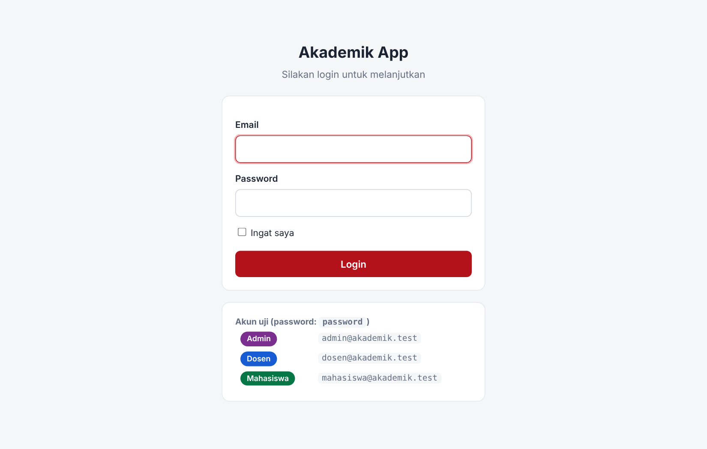 |
| Admin: dashboard | 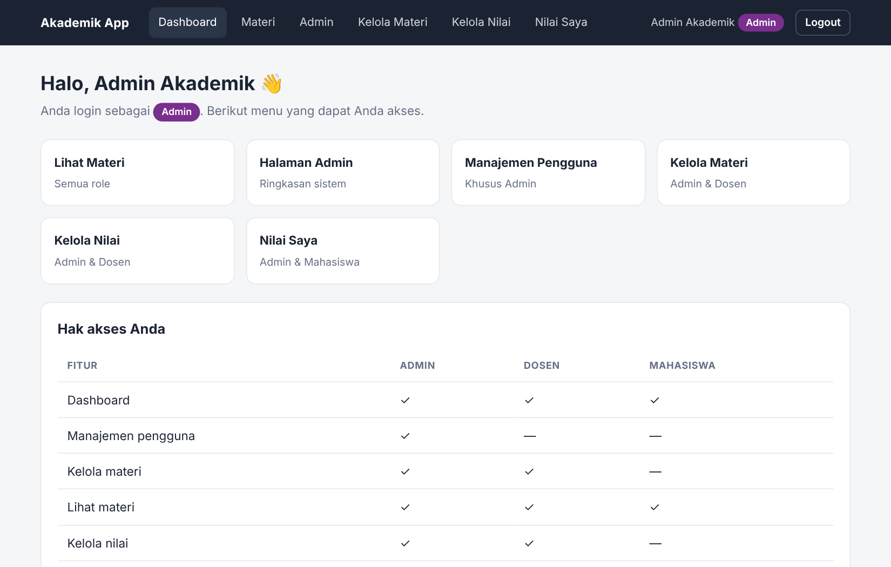 |
| Admin: halaman admin | 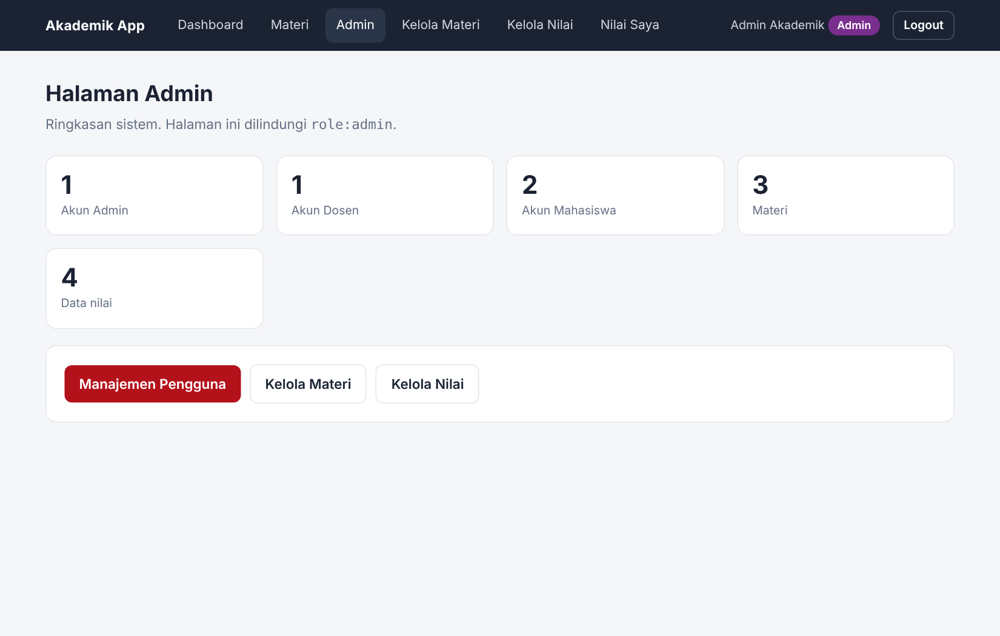 |
| Admin: manajemen pengguna ✅ | 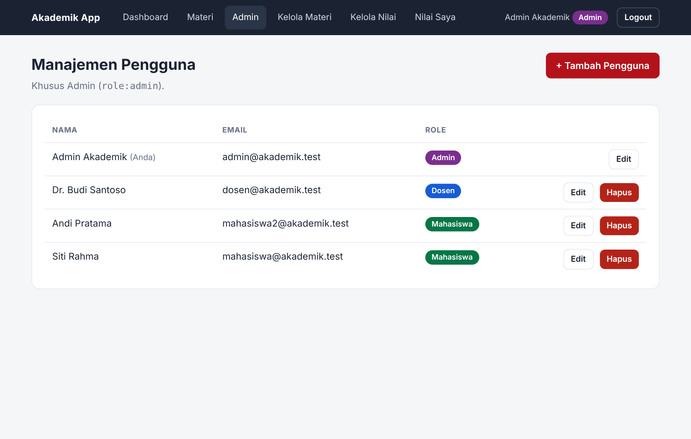 |
| Admin: kelola materi ✅ | 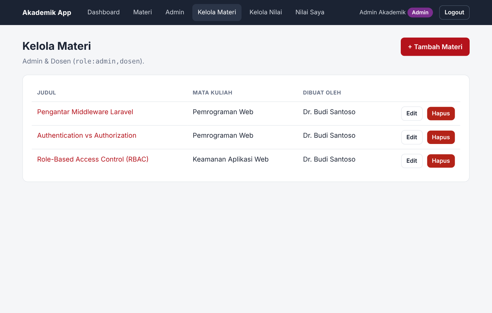 |
| Admin → `/dosen` ⛔ 403 | 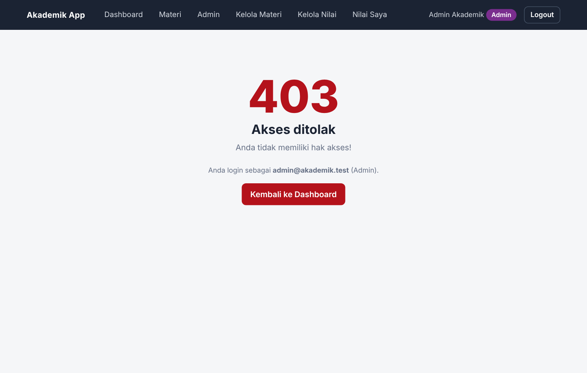 |
| Dosen: dashboard ✅ | 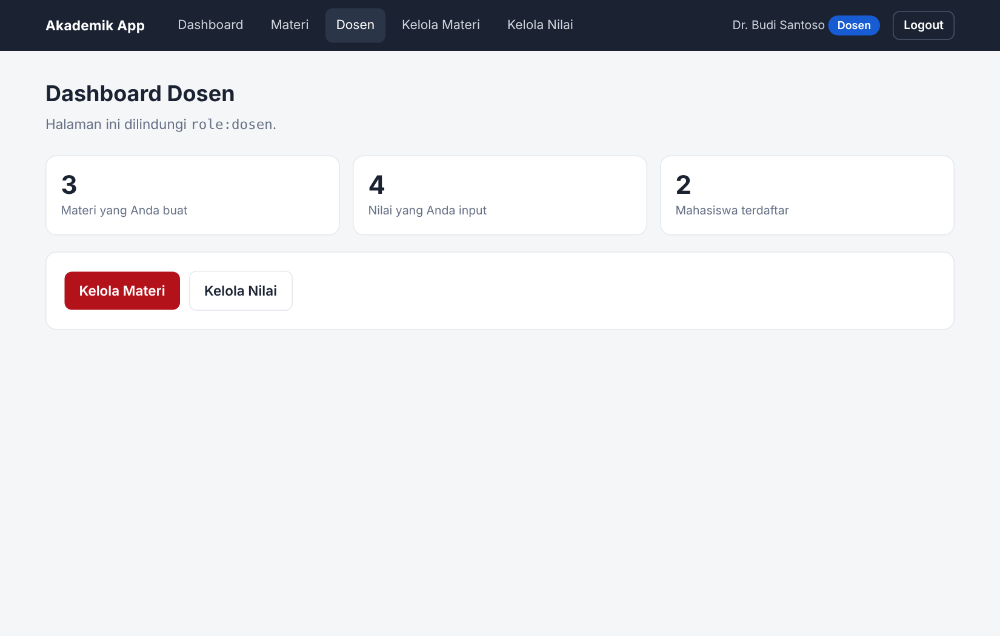 |
| Dosen: kelola nilai ✅ | 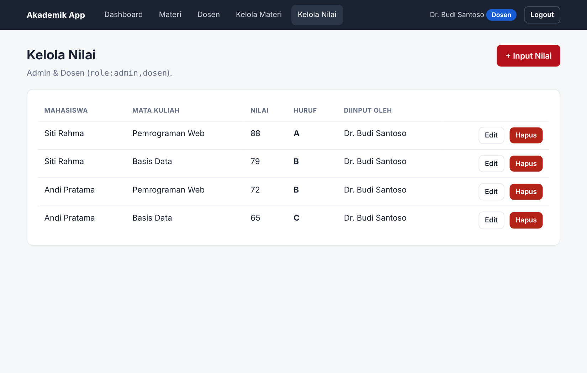 |
| Dosen → `/admin` ⛔ 403 | 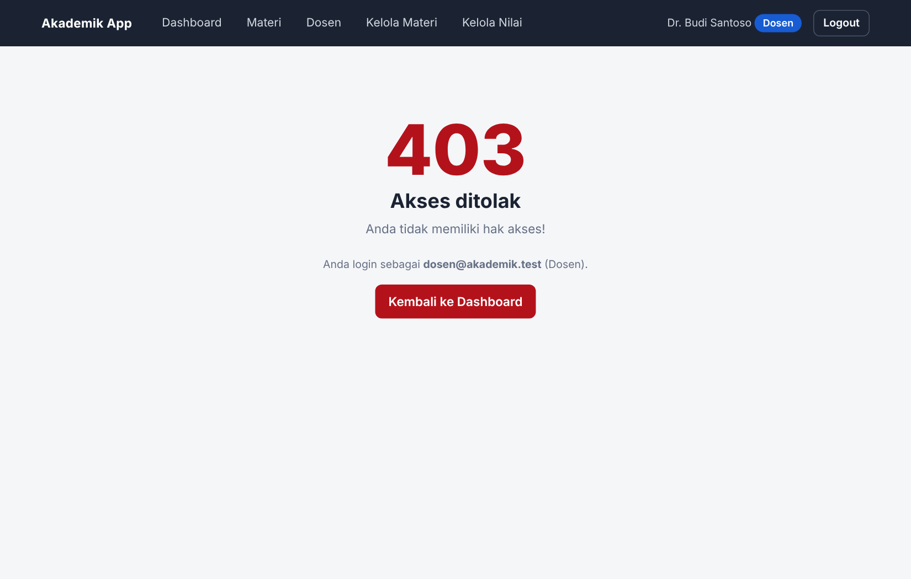 |
| Dosen → `/nilai-saya` ⛔ 403 |  |
| Mahasiswa: dashboard ✅ | 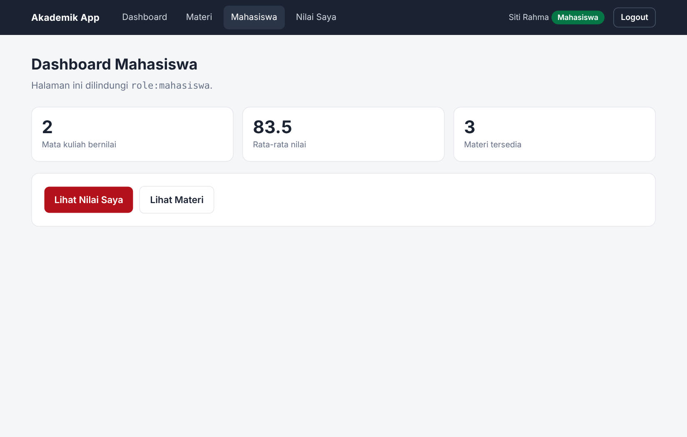 |
| Mahasiswa: nilai saya ✅ | 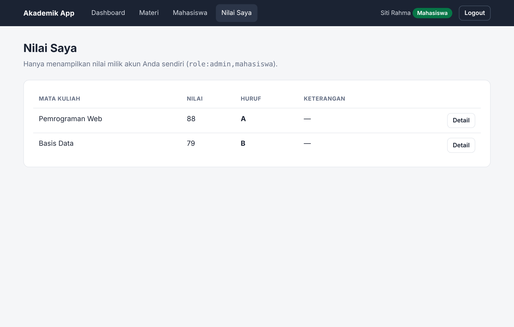 |
| Mahasiswa: materi ✅ | 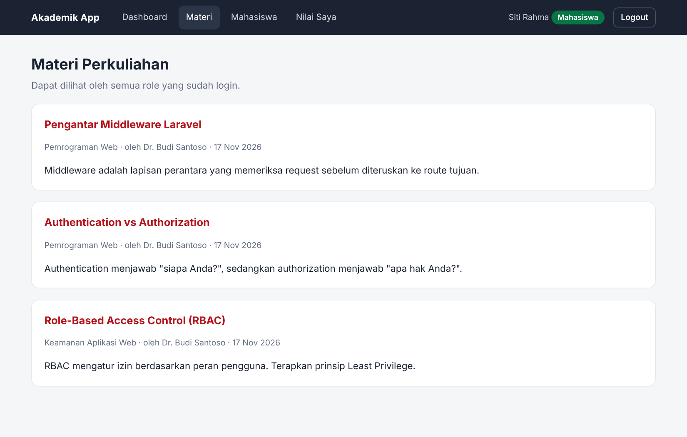 |
| Mahasiswa → `/kelola-materi` ⛔ 403 | 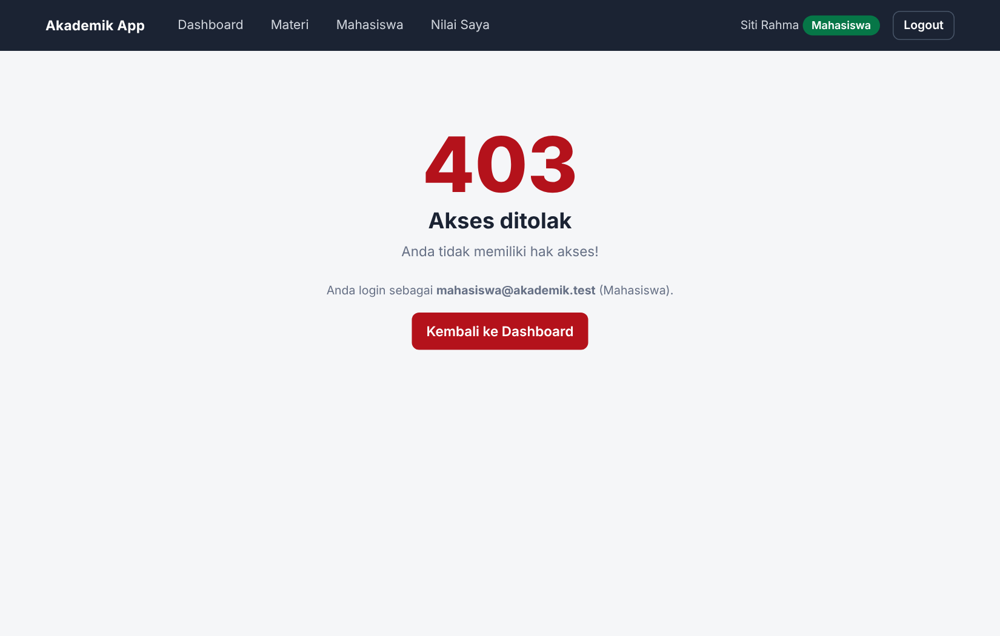 |
| Mahasiswa → `/admin/pengguna` ⛔ 403 |  |

## 7. Kesimpulan

1. Middleware `CheckRole` menyaring request **sebelum** controller berjalan: belum login → redirect ke login; role tidak sesuai → **403**; role sesuai → request diteruskan.
2. Satu middleware dapat menerima banyak role (`role:admin,dosen`), sehingga aturan akses cukup dideklarasikan sekali di `routes/web.php`.
3. Menyembunyikan menu **tidak cukup** — terbukti URL yang diketik langsung tetap ditolak oleh server.
4. Middleware melindungi **jalur (route)**, sedangkan **Policy** melindungi **data** (mahasiswa tidak dapat membuka nilai milik mahasiswa lain). Keduanya dipakai bersama untuk pertahanan berlapis.
